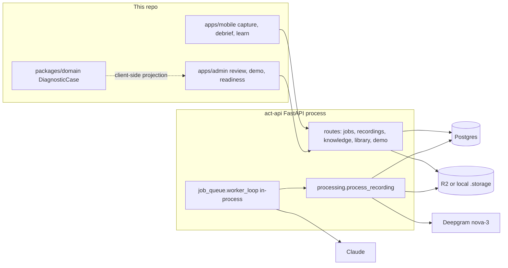

# Actober physical-work audit

**Audited:** 2026-10-04. Status vocabulary matches [truth-ledger.md](truth-ledger.md): a passing test suite is `IMPLEMENTED`, not a field capability. Nothing below is customer usage.

This audit stops before the pivot. No schema was replaced, no system was deleted, and no product code was edited.

## Audit record

| Item | Value |
|---|---|
| Client repo | `Evode-Manirahari/act`, branch `main`, commit `8a8eb737d77cc0e07b92a85bb06addb6a20f8496` (PR #81, 2026-09-07). Working tree was clean. |
| API repo | `/Users/evodemanirahari/act-api` (not a sibling of this checkout). Checked-out branch `backend/debrief-provider-failure`, commit `0aef641e15ff895f381bd4dc0cc7c9fb8a401c4e` (2026-08-19). |
| API on GitHub `main` | [`2a9a6378fd3336a55fc49c7f9d0fe2820f95861a`](https://github.com/Evode-Manirahari/act-api/commit/2a9a6378fd3336a55fc49c7f9d0fe2820f95861a) (2026-09-08). Five commits ahead of the local checkout. Code citations below use this commit. Those commits add deploy observability, an auth fail-closed guard, image packaging, and `app/services/mvp_publish.py`. They do not add telemetry, episodes, or a timeline. |
| Preserved local API state | Dirty and untouched: modified `uv.lock`; untracked `.claude/`, `.env.bak-20260819-165829`, `scripts/seed_staging_review.py`, `supabase/`. |
| Last documented production image | Truth ledger, 2026-08-07: API `07e89a3`, migration `0025`. Today's `GET /health` is still `{"ok":true,"db":true}` and does not include the `git_sha` / `migration` fields added on `origin/main` in #58. Dashboard counts match that 2026-08-07 snapshot. Live image digest was not re-read with `flyctl`. |

### What was executed

| Command | Result |
|---|---|
| `pnpm install` in this repo | Succeeded after a sandbox retry. Created gitignored `node_modules`. No dependency was upgraded. |
| `pnpm test` | `packages/domain` 78 passed, `apps/admin` 52 passed, `apps/mobile` 271 passed. |
| `act-api` `.venv/bin/pytest -q` on `0aef641` | **481 passed**, 23 warnings, 84s. SQLite in-memory. This does not exercise the Postgres lock bug below. |
| Production `GET /health`, `/health/capture`, `/dashboard/summary`, `/jobs`, `/library/search`, `/openapi.json` | See execution evidence. Reads only. No production write was attempted. |
| Local pipeline | Throwaway database `act_audit_20261004` on local Postgres. `alembic upgrade head` applied `0001`–`0025`. API on `127.0.0.1:8765` with **local disk storage** (R2 endpoint forced empty; `/health/capture` reported `storage.mode=local` before any upload), Deepgram `nova-3`, classifier off. Synthetic 16.4s MP4, macOS `say` plus ffmpeg, 155,356 bytes. Server stopped after the run. `act_staging` was queried for counts only and was not written. |

The staged local `.env` points `DATABASE_URL` at `localhost:5432/act_staging` and has Deepgram, Anthropic, R2, ElevenLabs, and LiveKit values set. `SUPABASE_URL`, `AUTH_REQUIRED`, and `VOYAGE_API_KEY` are absent. The audit process overrode the database URL and cleared S3 so the worker could not claim staging jobs or write to R2.

## 1. Architecture that actually runs



One Fly machine (`act-api-evode`, `shared-cpu-1x`, 1024 MB, `min_machines_running = 0`) runs Uvicorn and the Postgres queue worker in the same process (`app/main.py` lifespan). Redis is declared in this repo's `docker-compose.yml` and is not used by the API. The API's own compose file is Postgres only.

### Path that exists today

1. **Create job.** `POST /jobs`, or `POST /demo/session`, which inserts an account, user, and job. `POST /jobs/import-csv` imports job rows, not instrument time series.
2. **Create recording.** `POST /jobs/{id}/recordings` (`app/routes/recordings.py` `create_recording`) writes a `pending` row and a storage key `jobs/{job_id}/recordings/{id}.{ext}`. With S3 configured it returns a one-hour presigned PUT. Without S3 the client uses `POST /recordings/{id}/upload`, which reads the entire body into memory (`await file.read()`).
3. **Marks.** `recording_marks.timestamp_s` is seconds into the file. A mark is a hint. The pipeline treats it as a seed for a moment window, which is the right instinct and the wrong granularity (see P1-1).
4. **Finalize.** `POST /complete` stats the object (`storage.stat` distinguishes missing from unknown) and enqueues `process_recording`. The direct `/upload` route finalizes by itself and does not set `duration_s`.
5. **Process** (`app/services/processing.py` `process_recording`, claimed by `app/services/job_queue.py` `execute`):
   - download the object
   - ffmpeg mono 16 kHz WAV (`app/services/video.py`)
   - Deepgram utterances, or `transcribe._stub_segments()` which returns a canned script and ignores the audio
   - one JPEG every 5 seconds via `fps=1/5`, plus one JPEG per mark
   - `moment_rules.detect_moments` over transcript text and marks
   - optional Claude classifier, default off, transcript text only
6. **Review.** A person sets `moments.status`. Approval enqueues `generate_question`.
7. **Debrief.** Claude drafts `elicitation_questions`. An answer lands in `expert_answers`. `PATCH /answers/{id}` overwrites `transcript` in place.
8. **Compile.** One `knowledge_objects` row per moment (migration `0025`): situation, cue, reasoning, decision, trap, safety, verification, quiz. Grounding is token overlap (`app/services/grounding.py`). Publish requires eligibility (`app/services/knowledge_policy.py`, `app/services/evidence_eligibility.py`).
9. **Retrieve.** `GET /library/search` and `POST /library/ask` rank published cards by LIKE, or by Voyage cosine if `VOYAGE_API_KEY` is set. They do not search transcript segments.
10. **Practice and outcomes.** Training events and `job_outcomes` (callback flag, first-time fix). The readiness matrix in `packages/domain` is computed in the client. Live manager levels return 501 from `apps/admin` until an API table that does not exist on the deployed OpenAPI.

`packages/domain` `DiagnosticCase` (`packages/domain/src/case.ts`) is a client projection over a card. `ClaimType` already includes `observed_fact`, `measurement`, `technician_statement`, and `inference`. The API does not store those claims. `checkMvpPublish` (`packages/domain/src/provenance.ts`) is enforced in the admin client. `origin/main` ports it to `app/services/mvp_publish.py`; the running checkout and the production OpenAPI shape do not show that port as deployed.

### Active, abandoned, and stubbed

| Piece | State |
|---|---|
| Capture, queue, transcript, frames, moment rules, debrief, compile, publish gate, redaction request | Active code, with the Postgres deadlock in P0-2. |
| `transcribe_provider=stub` | Dev fixture. Returns fixed HVAC sentences. Not evidence about the audio. |
| `realtime_agent/` and `spikes/voice_debrief` | Scaffold. README says not verified end to end. `POST /realtime/token` is on the production OpenAPI and returns 503 when LiveKit is unset. |
| `packages/act-kb` electrical JSON | Retained stubs. HVAC pilot does not read them as the source of truth. |
| `apps/admin` `/demo`, `demo-` ids | Fictional shop. Write path refuses those ids. Not traction. |
| Claude vision over frames | Absent. Frames are stored JPEGs. The classifier prompt is transcript text (`app/services/moment_classifier.py`). |
| Measurement streams, sensor clocks, work episodes, correction history, segment search | Absent from models, migrations `0001`–`0025`, and the production OpenAPI (53 paths; no readiness, users, telemetry, episode, or timeline routes). |

## 2. Current capability versus the physical-work contract

| Required | What exists | Gap |
|---|---|---|
| Video + audio of a real job | Phone recording, presigned PUT or full-body POST, offline retry queue (`apps/mobile/src/lib/offlineUploadQueue.ts`) | Whole-file retry, not a resumable byte protocol. `duration_s` stays null on the `/upload` path. |
| Timestamped transcript | `transcript_segments.start_s/end_s`, speaker label, confidence. Proven on synthetic speech below. | Speaker is `spk_0`. No mapping to the technician. File time is the only clock. |
| Measurements and machine data | HVAC regex over speech (`moment_rules._HVAC_MEASUREMENT_RE`). Job CSV import. | No value, unit, device, or uncertainty column. A spoken number is a sentence. |
| Actions and outcomes | Card fields `decision` and `verification`, plus `job_outcomes` after the fact | An action sentence and a later callback flag. No state transition. Success is whatever the card text says. |
| Claim class: observed, measured, expert-stated, model-inferred | Domain `ClaimType` on the client | Not persisted. Moment `evidence_json` is rule hits (phrase lists, mark metadata). |
| Evidence link and source interval | Segment times; card `sources_json`; grounding token overlap | Overlap can attach a claim to the wrong sentence. Frames are not cited by vision. |
| Insufficient evidence | Compile refuses missing attestation, non-human answers, and invalidated chains | Refusal is at publish time of a lesson card. The pipeline still emits a moment when the outcome was never checked. |
| Learning = episodes, corrections, retrieval | Published-card search. Answer edit overwrites the row. | No episode object, no correction log, no segment retrieval. Weights are not trained, and the code does not claim they are. |
| Expert correction of times, boundaries, claims | `PATCH` moment, question, answer, card | In-place updates. No prior version, no actor history beyond a few reviewer columns. |
| Job Timeline | Admin moment page and mobile review show a card and a window | No synchronized video, transcript, measurements, and claims. |
| Search for a diagnostic moment | Card-level LIKE / optional embeddings | "High vibration + normal motor current" cannot hit a segment, and "high" has no threshold. |
| Evaluation harness | `packages/domain` debrief eval set; `act-api/evals/exp1_evidence_value` | No temporal-alignment, measurement, or unsupported-claim scores. No acceptance numbers exist. |
| Tenant isolation | `app/services/scoping.py` when a verified token is present | Production accepts anonymous reads and, by the same `AUTH_REQUIRED` default, anonymous writes. |

## 3. Findings

### P0 — release blockers

**P0-1. Production still accepts anonymous access.**

- Evidence: 2026-10-04 `GET https://act-api-evode.fly.dev/jobs` → 200, `GET /library/search` → 200 `[]`, `GET /dashboard/summary` → 200. OpenAPI still lists `POST /demo/session`. `/health` has no `git_sha`, so this is not the `origin/main` build that refuses to boot when `AUTH_REQUIRED` is on without a verifier.
- Code on GitHub `main`: [`get_auth_context`](https://github.com/Evode-Manirahari/act-api/blob/2a9a6378fd3336a55fc49c7f9d0fe2820f95861a/app/services/supabase_auth.py#L139-L157) returns `None` when no verifier is configured and `AUTH_REQUIRED` is off. If `AUTH_REQUIRED` is on with no verifier, that same function returns 503. Production's anonymous 200 means the flag is off; the 503 guard is not what is running. With no auth context, [`scoping.py`](https://github.com/Evode-Manirahari/act-api/blob/2a9a6378fd3336a55fc49c7f9d0fe2820f95861a/app/services/scoping.py#L41-L45) loads by primary key. The mobile gate has the same default: [`PilotNavigator.tsx`](https://github.com/Evode-Manirahari/act/blob/8a8eb737d77cc0e07b92a85bb06addb6a20f8496/apps/mobile/src/navigation/PilotNavigator.tsx#L45-L53).
- Impact: anyone who can reach the host can read pilot rows and call write routes. The truth ledger's Risk 3 is still open. Dashboard numbers have not grown since 2026-08-07, which limits the data exposed today; it does not change the control.
- Fix: set `SUPABASE_URL` and `AUTH_REQUIRED=true` on the Fly app before any named user, using the fail-closed guard already on `origin/main`. Do not treat this as a pivot task.

**P0-2. Question generation deadlocks on Postgres.**

- Evidence: on `act_audit_20261004`, after a real Deepgram success, `PATCH` approve enqueued `generate_question` and the client `POST /moments/{id}/questions`. Both blocked. `pg_stat_activity` showed the request transaction `idle in transaction` after `SELECT transcript_segments...`, an `INSERT INTO agent_runs` waiting on `transactionid`, and the worker's `SELECT moments ... FOR UPDATE` waiting on `tuple`. No socket to Anthropic was opened. The question row count stayed 0. The API process was killed to release the sessions.
- Mechanism, on GitHub `main`: [`create_question_for_moment`](https://github.com/Evode-Manirahari/act-api/blob/2a9a6378fd3336a55fc49c7f9d0fe2820f95861a/app/routes/knowledge.py#L414-L440) takes [`lock_moment`](https://github.com/Evode-Manirahari/act-api/blob/2a9a6378fd3336a55fc49c7f9d0fe2820f95861a/app/services/moment_lock.py#L47-L58) (`FOR UPDATE`) and, still inside that transaction, calls [`start_run`](https://github.com/Evode-Manirahari/act-api/blob/2a9a6378fd3336a55fc49c7f9d0fe2820f95861a/app/services/agent_runs.py#L86-L101). `start_run` commits on a second connection and inserts `agent_runs.moment_id`, a foreign key to the locked `moments` row. The insert waits for the row lock. The row lock waits for the insert. Postgres does not abort it, because the lock holder is idle in the application, not waiting inside Postgres. [`compile_knowledge_object_route`](https://github.com/Evode-Manirahari/act-api/blob/2a9a6378fd3336a55fc49c7f9d0fe2820f95861a/app/routes/knowledge.py#L729-L820) uses the same order. The deployed commit `07e89a3` has the same order at lines 413/431 and 724/815.
- Why tests stayed green: the default suite is SQLite, where `supports_row_lock` is false. Provenance writes go to a second in-memory engine (`tests/conftest.py` `agent_runs_factory`), so the foreign key never touches the locked row.
- Deployed code: `07e89a3` already contains this order. That is the image the truth ledger recorded as production on 2026-08-07. Today's health payload is consistent with that generation. This audit did not re-fetch the Fly image digest.
- Impact: approving a moment can wedge a database connection in the same process as the API. The debrief step of the current product does not finish.
- Fix: commit or release the moment lock before any other transaction inserts a row that references it. Hold the lock only around the read-and-insert of the question or card. Add a Postgres test that does not redirect `agent_runs` to another database.

### P1 — required for the MVP

**P1-1. Moments are lesson windows, not a physical sequence.**

- Evidence: the synthetic clip contained five Deepgram segments (no-cool arrival, subcooling 3 degrees, hypothesis of low charge rather than TXV, refrigerant added, subcooling 10 and "I verified"). Marks at 2s, 8s, and 14s. `detect_moments` stored **one** `sensory_cue` from 0s to 20s, score 5. `_merge_overlapping` keeps the higher score and expands the window; manual marks start at score 5 with ±6s padding (`moment_rules.py`).
- Impact: the timeline the MVP needs is destroyed before anyone can correct it. A measurement, a hypothesis, an action, and a verification become one teachable moment.
- Fix: keep segment rows immutable and build episode events from segments. Stop using merged moment windows as the only temporal object.

**P1-2. Spoken numbers are not measurements, and outcomes are not verified.**

- Evidence: `_HVAC_MEASUREMENT_RE` sets `measurement_then_decision` in `evidence_json`. There is no numeric value, unit, source, or uncertainty. `KnowledgeObject.verification` is prose. `job_outcomes` is a later form.
- Impact: "subcooling is three degrees" cannot be retrieved as a measurement, and "I verified the repair" would be stored as success if a card were compiled from it.
- Fix: parse a measurement claim only as expert-stated unless an instrument row exists. Default outcome to insufficient evidence when the only support is the action itself or an unverified speech act.

**P1-3. No clock except "seconds from the start of this file."**

- Evidence: `TranscriptSegment.start_s`, `ExtractedFrame.timestamp_s`, `RecordingMark.timestamp_s` are floats. `processing.py` assigns sampled frame time as `idx * 5`. On this clip ffmpeg returned 3 sampled frames at 0, 5, and 10, and the file was 16.4s, so the verification sentence (11.43–16.39) has a mark frame at 14s and no sampled frame. `duration_s` stayed null. Nothing stores container PTS, a device clock, an offset, or alignment uncertainty.
- Impact: a second stream cannot be aligned without pretending the offset is zero.
- Fix: store file-relative intervals as the session timebase for a single recording, and store an explicit unknown offset for any later stream.

**P1-4. Human edits erase the previous text.**

- Evidence: `edit_answer` assigns `answer.transcript = payload.transcript`. `KnowledgeObject` has no version column. `DiagnosticCase.version` lives in `packages/domain` and is not a table.
- Impact: an expert correction cannot be evaluated against the model output, and a reprocess cannot tell what a person already accepted.
- Fix: append-only correction rows. The accepted interpretation is a pointer.

**P1-5. Search returns whole cards.**

- Evidence: `search_library` filters `knowledge_policy.product_eligible_clauses()` and ranks narrative fields. Production search returns `[]` because published eligible cards are 0. Voyage is unset in the local env and is optional.
- Impact: a diagnostic moment inside a long job is not a retrieval unit. Qualitative words such as "high" match only if they appear in card text.
- Fix: index episode claims and their source intervals. Bind "high" and "normal" to an expert statement or a stored threshold on that claim.

**P1-6. Purge does not cover every derived artifact.**

- Evidence: `app/services/redaction.py` `purge_recording_media` deletes the video key and frame keys, deletes transcript and frame rows, and sets cards to `archived`. It leaves moments, `evidence_json`, expert-answer audio keys, `embedding_json`, and `agent_runs` output in place.
- Impact: a customer deletion request would not clear derived text or embeddings. There is no customer corpus in the ledger; the hole is still a pilot blocker.
- Fix: extend purge to answer audio, episode claims, embeddings, and agent-run payloads for that recording, in one transaction with the raw delete.

**P1-7. Large uploads are not resumable, and retries re-bill transcription.**

- Evidence: mobile `uploadRecordingFile` uses `FileSystem.uploadAsync` for the whole file. The queue retries the item (`offlineUploadQueue.ts`, max 5). `job_queue._clear_partial_artifacts` deletes segments and proposed moments, then `process_recording` calls Deepgram again.
- Impact: a dropped connection on a long job resends the file and can pay for a second transcript. The queue is durable across an app restart; the byte transfer is not.
- Fix: keep the existing queue. Add multipart or offset resume on the storage PUT, and skip Deepgram when the stored audio hash matches a succeeded transcript.

**P1-8. There is no annotated corpus.**

- Evidence: production dashboard on 2026-10-04: `recordings_total=22`, `recordings_ready=8`, `moments_approved=4`, `knowledge_objects_published=0`, `training_events_total=0`, `jobs_with_outcomes=5`, `callbacks=1`. That matches the 2026-08-07 ledger, which classified those recordings as app tests. Local `act_staging` has 2 `ready` recordings, both `capture_class=internal_product_test`, 0 frames, `bytes_uploaded` null, identical `TEST_DATA` transcript text, and 0 cards. One `generate_question` job failed with `TEST_DATA cleared: no anthropic credit`.
- Impact: no metric in the MVP plan can be reported as measured. The synthetic clip in this audit is a fixture.
- Fix: annotate a handful of jobs, starting with the synthetic script as a labeled fixture, and keep `capture_class` off `genuine_field_work` until a person attests it.

### P2 — after the golden path

**P2-1. In-process worker on a machine that scales to zero.** `fly.toml` `min_machines_running = 0` and `auto_stop_machines = stop`. A stopped machine does not finish a queue. Acceptable at one-operator volume only after jobs are observable. `GET /health` on production cannot answer "which commit is this?"

**P2-2. Frame extraction spends storage and is unused by models.** Six JPEGs were written for a 16-second clip and no model looked at them.

**P2-3. Embeddings live in a JSON column** (`KnowledgeObject.embedding_json`) and are reranked in Python over a 500-card pool (`library.py` `_RERANK_POOL_SIZE`). Fine until the library is large. Voyage was not configured in the env inspected.

**P2-4. Nine `agent_runs` rows on `act_staging` are stuck `running` for `outcome_report`.** Current `weekly_report` does call `fail_run` on provider errors (`library.py`). Those nine rows were not reproduced in this audit. They are a stale-run smell, not the deadlock above.

**P2-5. Two product objects for one lesson.** `knowledge_objects` in Postgres and `DiagnosticCase` in `packages/domain`, plus fictional demo cases. The pivot should add an episode and project a card from it later, rather than grow a third parallel compiler.

**P2-6. `packages/act-kb` and the LiveKit debrief** are leftover surfaces. Leave them in the tree until the episode path is the one mobile opens. Do not extend them.

## 4. Reliability, security, and cost

| Area | Observation |
|---|---|
| Idempotent media job | `processing_jobs` unique partial index for one active `process_recording` per recording. Reclaim uses heartbeat and `job_visibility_timeout_s` (900s). A `ready` recording is not reprocessed if the job row is reclaimed (`job_queue.execute`). |
| Not idempotent | Question and compile locks deadlock instead of deduplicating (P0-2). Transcript retries call Deepgram again (P1-7). |
| Partial failure | Pipeline commits segments before `status=ready`. A crash is repaired by deleting proposed artifacts and rerunning. Reviewed moments are kept. |
| Provider failure | Classifier errors are swallowed and rule output remains. Question and compile HTTP failures are supposed to settle `agent_runs` and return 502. They never got that far in this run. Staging recorded an Anthropic credit failure on an older attempt. |
| Authz | Designed correctly behind a verified token (`scoping.py`). Off in production (P0-1). Workers trust rows already in the database, which is safe only after anonymous enqueue is impossible. |
| Media access | Presigned GET/PUT, one hour (`storage.py` `_PRESIGN_EXPIRY`). Local mode writes `.storage/` with no auth because the API in front is expected to be the gate. |
| Logging | `/health/capture` reports key presence, not the key. This audit did not find transcript bodies in the API log. The Deepgram request URL includes the HVAC keyterm list. |
| Tests versus production | 481 passing tests did not create the deadlock. Do not read that suite as an end-to-end pass. |

## 5. Leave these alone

- Evidence eligibility and capture attestation (`evidence_eligibility.py`, `capture_attestation.py`, migrations `0020`–`0022`). Fail-closed publish is the right instinct. Point it at episode claims later; do not loosen it.
- `storage.stat` three-way result (present, absent, unknown) and the stale-upload sweeper (`recording_finalize_timeout_s`).
- The Postgres queue for media processing: heartbeat, backoff, single active job per recording.
- Mobile offline queue ordering (upload, then complete, then process) and the auth gate that fails closed when Supabase config is partial (`authGateModel`).
- Consent and the redaction *request* state. Extend purge; do not replace the state machine.
- `packages/domain` answer-rejection and grounding thresholds. They encode the 2026-07-31 incident. Keep them as a check on expert-answer text. They are not an episode model.
- Demo shop id prefix and the rule that demo data is never traction.

## 6. Execution evidence

**Production, 2026-10-04, read-only**

```text
GET /health
{"ok":true,"db":true}

GET /health/capture
db ok, ffmpeg /usr/bin/ffmpeg, storage s3 bucket act-frames ok,
transcribe deepgram key_present true, claude ok
(claude ok means the key is non-empty, not that a completion succeeded)

GET /dashboard/summary
recordings_total 22, recordings_ready 8, moments_proposed 0,
moments_approved 4, knowledge_objects_published 0,
training_events_total 0, jobs_with_outcomes 5, callbacks 1

GET /jobs → 200 (body not stored)
GET /library/search → 200 []
OpenAPI path count 53, no episode, telemetry, readiness, or /users
```

**Local synthetic job (not a field recording, not a benchmark)**

Speech track, generated for this audit:

> No cool call on a three ton package unit. The suction line is sweating. Subcooling is three degrees. I think this is low charge, not a bad TXV. I added refrigerant. Subcooling is now ten degrees and the suction line dried up. I verified the repair.

Deepgram `nova-3` HTTP 200. Five segments, speaker `spk_0`, confidence 0.98–1.00, times 0.00–4.24, 4.40–6.16, 6.40–9.44, 9.75–11.35, 11.43–16.39. The words match the script, including both subcooling figures. That is one fixture, not an accuracy rate.

Pipeline then wrote 3 sampled frames and 3 mark frames, `recording.status=ready`, `bytes_uploaded=155356`, `duration_s` null, and one `sensory_cue` moment. `generate_question` stayed `running` with zero question rows until the process was killed. See P0-2.

**Not claimed**

- No phone capture was run.
- No production write, no R2 write, no staging write.
- Anthropic was not reached on this run, so credit was not re-tested. Staging's older job text says a previous call failed for lack of credit.
- Admin and mobile were not opened in a browser. Their automated tests passed. There is no Job Timeline UI to exercise.
